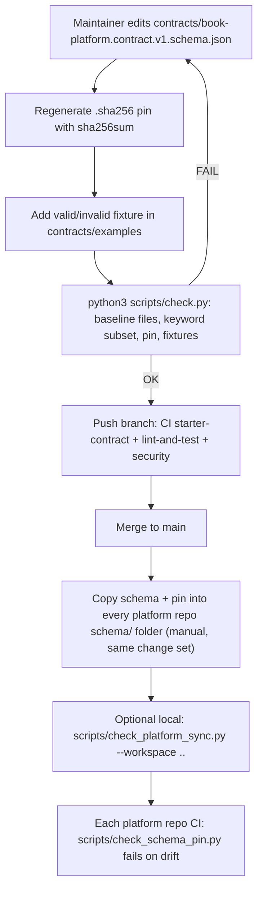
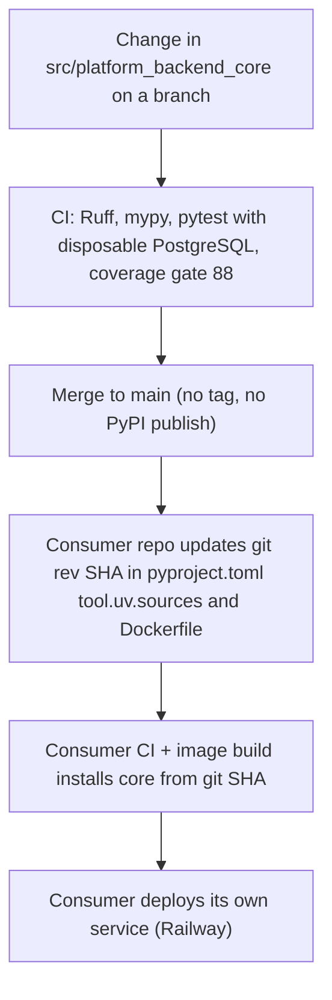
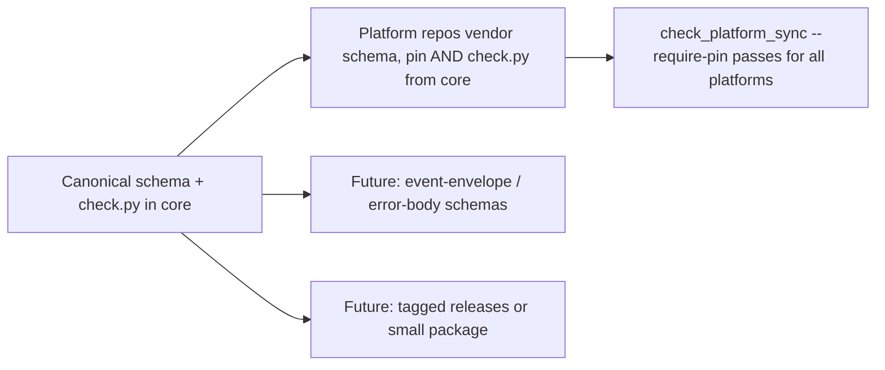

# 01 — Business process (As-Is / To-Be)

repo นี้เป็น **shared library + canonical contract schema** ไม่ใช่ service ที่ deploy เอง (PRODUCT.md: "nothing here is deployed")
"กระบวนการธุรกิจ" จึงเป็นกระบวนการภายในของ platform: (A) การเปลี่ยน contract schema กลาง และ (B) การออก runtime ให้ platform service ใช้

## As-Is (จากโค้ดและ docs วันนี้)

### A. เปลี่ยน contract schema

Sources: contracts/README.md, scripts/check.py, scripts/check_platform_sync.py, .github/workflows/ci.yml, docs/DECISION.md

### B. ออก runtime ให้ consumer

Sources: pyproject.toml, docs/runtime.md (Installation), .github/workflows/ci.yml, PRODUCT.md (Consumers), consumer pins seen in sibling repos (platform-commerce/pyproject.toml, platform-commerce/Dockerfile), ops record: book-platforms-status (2026-11-03)

## To-Be (จาก docs/UPGRADE-PLAN.md และ docs/DECISION.md เท่านั้น)

- P0: vendor schema pin เข้า `book-api-gateway` และ `book-media-platform` แล้วรัน `check_platform_sync.py --require-pin`
- P0 / DECISION follow-up: ให้ `scripts/check.py` ของ platform repo มาจาก repo นี้ที่เดียว (แทน vendored copies)
- P1: shared event-envelope และ error-body schemas เมื่อมี 2 platform ต้องใช้ shape เดียวกัน
- P2: ตัดสินใจ packaging ของ shared contracts (tagged releases หรือ package เล็ก)

Sources: docs/UPGRADE-PLAN.md, docs/DECISION.md

## Open questions

- UPGRADE-PLAN.md ยังเรียกชื่อเดิม (`book-api-gateway`, `book-media-platform`) — ปัจจุบัน `platform-api-gateway`, `platform-media` vendor pin แล้วหรือยัง? (DECISION.md 2026-10-15 ระบุ 10 repo มี pin)
- การ copy schema ไปทุก repo ยังทำมือ: จะ automate หรือไม่?
