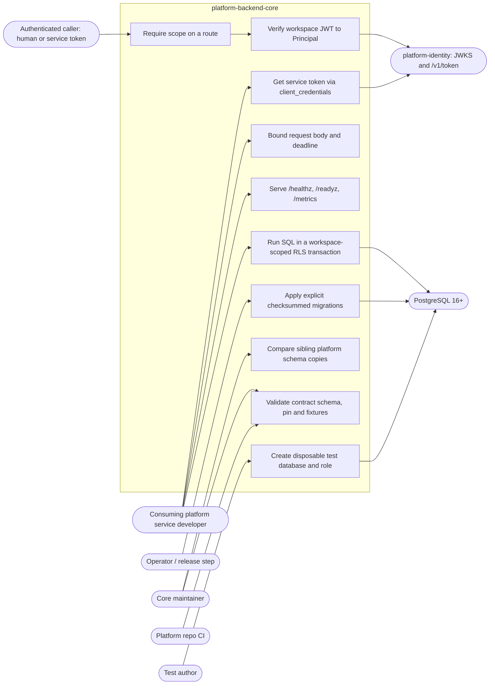

# 02 — Use cases

Actors คือ "ผู้ใช้" จริงของ library นี้: consuming service (และ developer ของมัน), CI ของ platform repo, operator ที่รัน migration,
maintainer ของ core และ external system (identity, PostgreSQL) ไม่มี end-user ตรง — end user/caller ของ consumer ถูกแทนด้วย
"Authenticated caller" ที่ถือ RS256 workspace token

Sources: src/platform_backend_core/__init__.py, auth.py, http.py, db.py, migrations.py, service_token.py, testing.py, scripts/check.py, scripts/check_platform_sync.py, docs/runtime.md, contracts/README.md

| Actor | ระดับสิทธิ์ใน code |
|---|---|
| Authenticated caller | RS256 token: `sub`, `ws` (UUID), `scope` space-separated; ไม่มี scope = ไม่มีสิทธิ์; `del`/`obo` ถูกปฏิเสธ (auth.py) |
| Consuming service | runtime DB role ต้อง `NOSUPERUSER NOBYPASSRLS` (db.py `_configure`) |
| Operator | migration DSN แยก (`--dsn-env DATABASE_MIGRATION_DSN`) เป็นเจ้าของ DDL (migrations.py, runtime.md) |
| Test author | admin DSN ที่ create/drop DB/role ได้ (testing.py) |

Sources: src/platform_backend_core/auth.py, db.py, migrations.py, testing.py, docs/runtime.md

## Open questions

- ไม่มี

