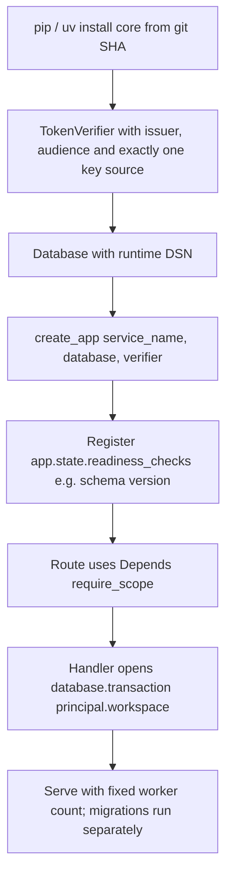
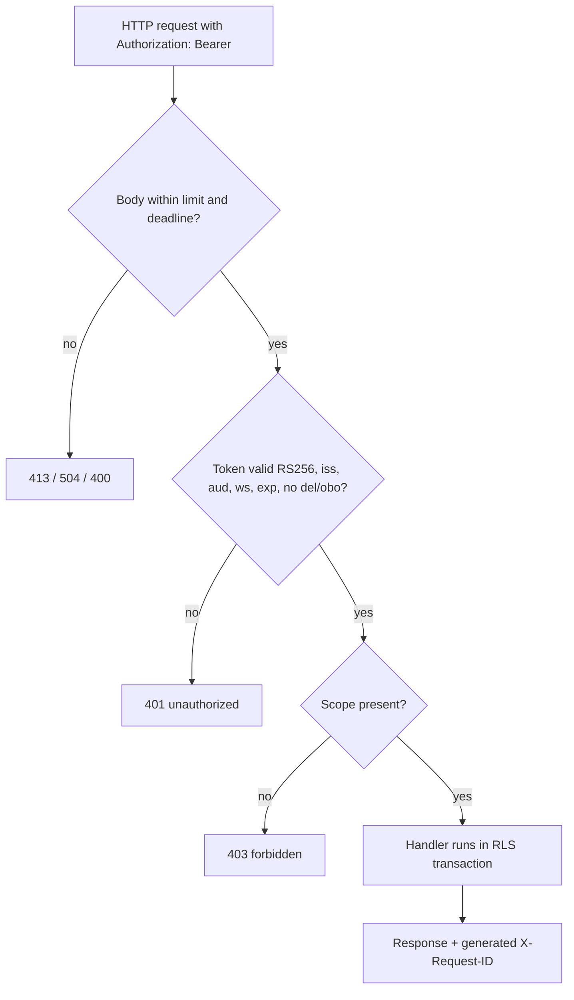
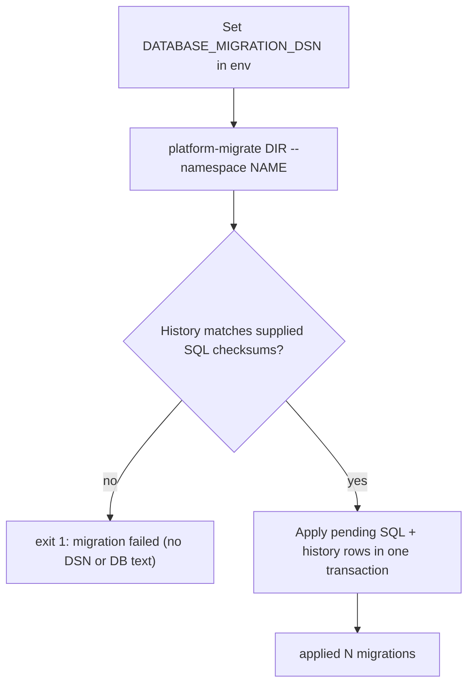
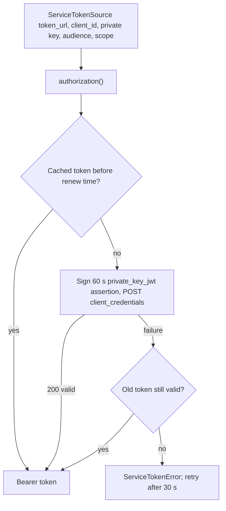

# 03 — User flows (ต่อ role)

ไม่มี UI/pages; flow คือเส้นทางที่แต่ละ actor ใช้ library

## Service developer: ต่อ runtime เข้า service

Sources: docs/runtime.md (Installation, HTTP integration), src/platform_backend_core/http.py, db.py, auth.py

## Caller: request ผ่าน consumer

Sources: src/platform_backend_core/http.py, auth.py, runtime_tests/test_http.py

## Operator: migration

Sources: src/platform_backend_core/migrations.py, docs/runtime.md (Explicit migrations)

## Service-to-service caller: service token

Sources: src/platform_backend_core/service_token.py, platform-workflow/src/platform_workflow/cli.py (consumer example, sibling repo)

## Maintainer: schema change — ดู [01-business-process.md](01-business-process.md) flow A (reused)

## Open questions

- ไม่มี
