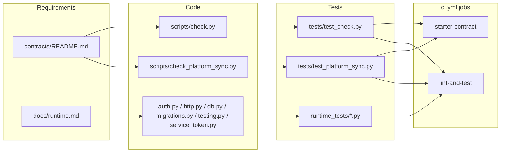

# 04 — Traceability (RTM)

ไม่มี `specs/` ใน repo; requirement ดึงจาก PRODUCT.md, contracts/README.md และ docs/runtime.md ("Stable public interface" และกฎต่าง ๆ)
"Release/workflow" = job ใน `.github/workflows/ci.yml` ที่รัน test นั้น (repo ไม่มี release/tag)

| ID | Requirement (source) | Code module | Test file | CI job |
|---|---|---|---|---|
| R1 | Canonical schema ใช้เฉพาะ JSON Schema subset (contracts/README.md) | scripts/check.py `unsupported_keywords` | tests/test_check.py | starter-contract, lint-and-test |
| R2 | Pin `.sha256` ตรงกับ schema (contracts/README.md) | scripts/check.py `pin_errors` | tests/test_platform_sync.py `CanonicalPinTests` | starter-contract |
| R3 | valid/ ผ่าน, invalid/ ไม่ผ่าน (contracts/README.md) | scripts/check.py `validate`, contracts/examples/ | tests/test_check.py | starter-contract |
| R4 | ตรวจ sibling platform copies (README.md) | scripts/check_platform_sync.py | tests/test_platform_sync.py `PlatformSyncTests` | starter-contract (unit only; script ไม่รันกับ repo จริงใน CI) |
| R5 | RS256 workspace JWT, strict claims, fail closed (runtime.md) | src/platform_backend_core/auth.py `TokenVerifier` | runtime_tests/test_auth.py | lint-and-test |
| R6 | JWKS HTTPS only, ≤1 MiB/64 keys, refresh ≤1/min, failed refresh clears cache (runtime.md) | auth.py `_JWKS` | runtime_tests/test_auth.py `test_jwks_*` | lint-and-test |
| R7 | ปฏิเสธ `del`/`obo` (runtime.md) | auth.py `verify` | runtime_tests/test_auth.py `test_unsupported_delegation_*` | lint-and-test |
| R8 | 401/403 + scope dependency (runtime.md) | src/platform_backend_core/http.py `require_scope` | runtime_tests/test_http.py | lint-and-test |
| R9 | Body/deadline bounds, safe errors, ไม่ echo input (runtime.md) | http.py `_Boundary`, `invalid_request` | runtime_tests/test_http.py `test_body_and_deadline_bounds`, `test_chunked_*`, `test_validation_errors_*` | lint-and-test |
| R10 | /healthz, /readyz fail closed, readiness_checks (runtime.md) | http.py `create_app` | runtime_tests/test_http.py `test_health_*`, `test_consumer_readiness_*` | lint-and-test |
| R11 | /metrics route template only (runtime.md) | http.py `metric_response` | runtime_tests/test_http.py `test_chunked_body_limit_and_metric_route_redaction` | lint-and-test |
| R12 | RLS per transaction, NOBYPASSRLS role, pool reset (runtime.md) | src/platform_backend_core/db.py | runtime_tests/test_database.py `test_rls_*`, `test_database_refuses_privileged_runtime_role` | lint-and-test (postgres: true) |
| R13 | Pool bounds + serverless timeouts (runtime.md) | db.py `__init__` | runtime_tests/test_database.py `test_pool_*`, `test_defaults_allow_*`, `test_connect_timeout_*` | lint-and-test |
| R14 | Migrations ordered, checksummed, advisory locks, atomic (runtime.md) | src/platform_backend_core/migrations.py `MigrationRunner` | runtime_tests/test_database.py `test_migration_*`, `test_first_migrations_*` | lint-and-test |
| R15 | `platform-migrate` CLI ไม่พิมพ์ DSN (runtime.md) | migrations.py `main` | **ไม่มี test** | — |
| R16 | Disposable DB/role fixtures (runtime.md) | src/platform_backend_core/testing.py | runtime_tests/test_testing.py | lint-and-test |
| R17 | Service token client_credentials, ไม่ log key/token (service_token.py docstring, PR #10) | src/platform_backend_core/service_token.py | runtime_tests/test_service_token.py | lint-and-test |
| R18 | Coverage ≥ 88% (ci.yml, ADR-0004 central) | ทั้ง src + scripts (pyproject.toml coverage) | ทั้งชุด | lint-and-test `coverage-threshold: "88"` |

Sources: PRODUCT.md, contracts/README.md, docs/runtime.md, src/platform_backend_core/*.py, scripts/*.py, tests/*.py, runtime_tests/*.py, .github/workflows/ci.yml, pyproject.toml

Sources: เหมือนตารางด้านบน

## Open questions

- `platform-migrate` CLI (`migrations.main`) ไม่มี test — ตั้งใจหรือไม่?
- ไม่มี requirement ID ทางการ (specs/) — จะใช้ ID ชุดนี้หรือ BOO-xxx ของ Linear?
