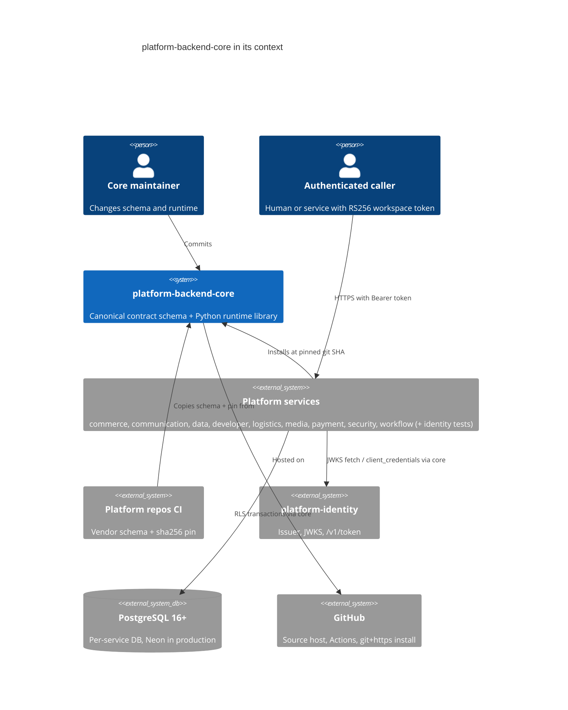

# 05 — C4 Context

library ไม่มี runtime ของตัวเอง; context จึงแสดง core **ภายใน** consumer services และระบบรอบ ๆ

Sources: README.md, PRODUCT.md, contracts/README.md, docs/DECISION.md, docs/runtime.md, src/platform_backend_core/auth.py, service_token.py, db.py; consumer pins in sibling repos (platform-*/pyproject.toml); ops record: book-platforms-status (2026-11-03) for identity issuer/JWKS and Neon

## Open questions

- PRODUCT.md ระบุ consumers แค่ data, security, workflow — แต่ origin/main ของ 9 repo pin core แล้ว (ดู 16) ควรอัปเดต PRODUCT.md
