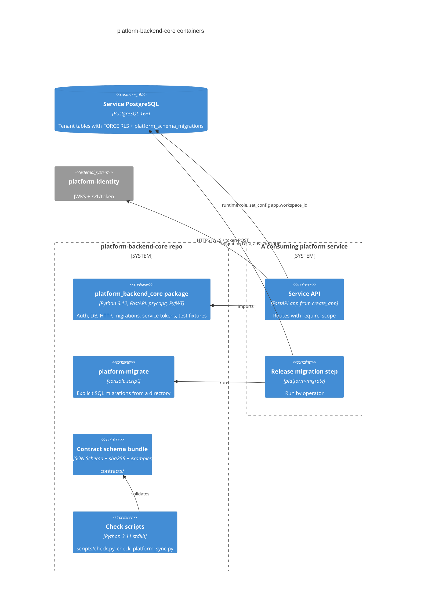

# 06 — C4 Container

"Containers" ของ repo นี้คือ artefacts ที่ส่งออก: Python package, CLI, contract schema bundle, และ check scripts; แสดงใน consumer service container

Sources: pyproject.toml (`[project.scripts]`, dependencies), src/platform_backend_core/*.py, contracts/, scripts/check.py, scripts/check_platform_sync.py, docs/runtime.md

## Open questions

- ไม่มี
