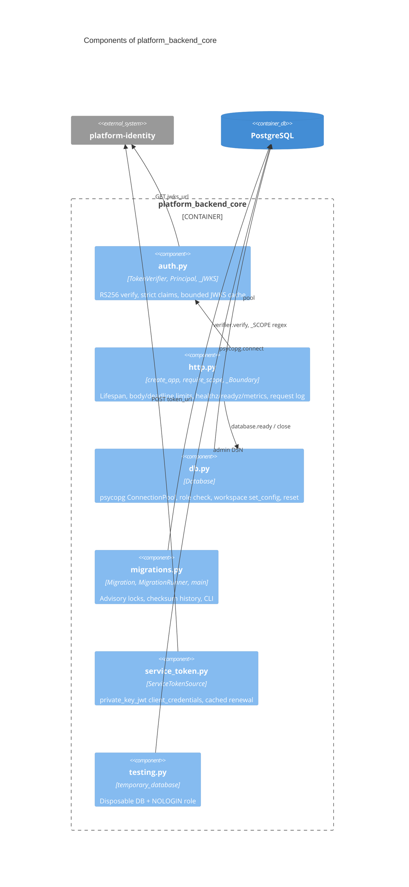

# 07 — C4 Component (package `platform_backend_core`)

Sources: src/platform_backend_core/__init__.py, auth.py, http.py, db.py, migrations.py, service_token.py, testing.py

หมายเหตุ: `http.py` import `_SCOPE` และ `AuthenticationError` จาก `auth.py`; `service_token.py` ไม่ขึ้นกับ module อื่นใน package

## Open questions

- ไม่มี
