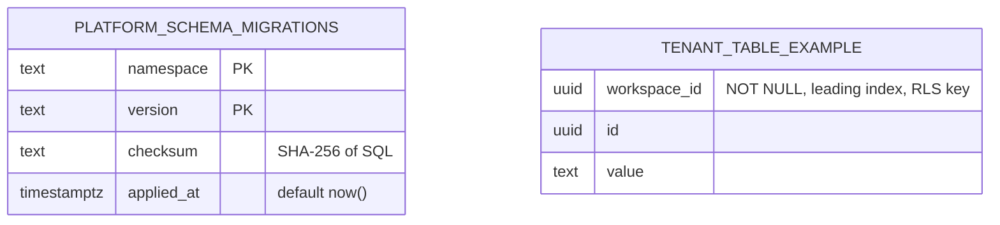
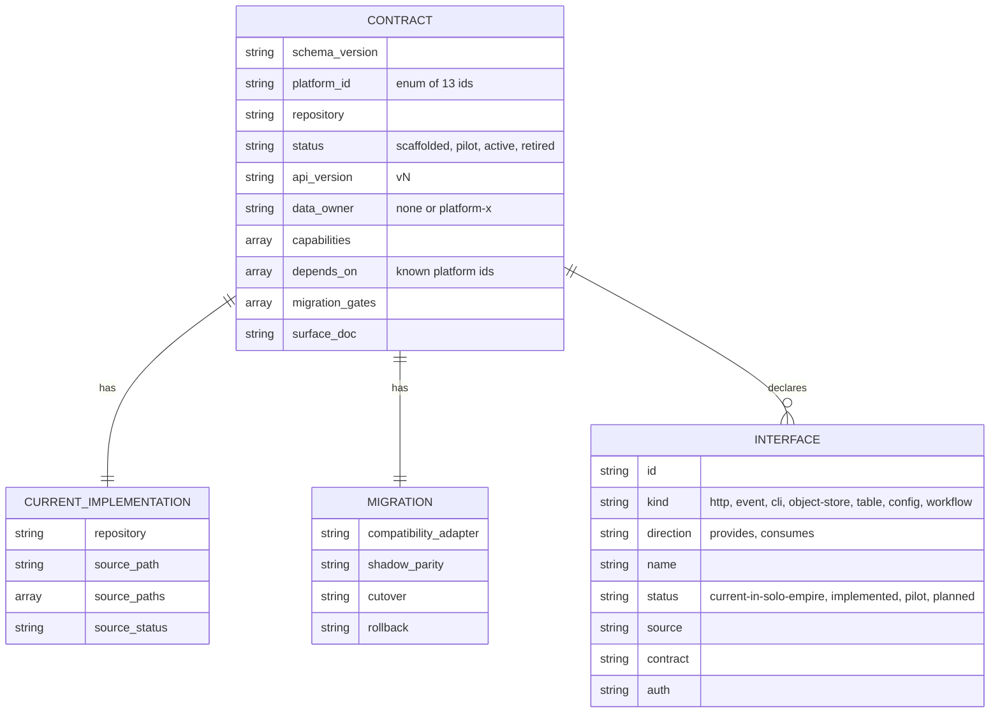

# 09 — ERD

core ไม่มี database ของตัวเอง แต่ **สร้างตารางหนึ่งตัวใน DB ของ consumer** (`platform_schema_migrations`) และกำหนด shape ของ
tenant table ที่ consumer ต้องทำตาม ส่วน contract document (`contract.json`) เป็นข้อมูล persisted ในรูปไฟล์ของแต่ละ platform repo

## ตารางที่ core สร้าง + shape ของ tenant table ที่บังคับใช้

Sources: src/platform_backend_core/migrations.py (`CREATE TABLE IF NOT EXISTS platform_schema_migrations`), docs/runtime.md (ตัวอย่าง `items` + RLS policy)

## Contract document (`contract.json`, validated by the canonical schema)

Sources: contracts/book-platform.contract.v1.schema.json, contracts/README.md (Contract fields)

## Open questions

- ไม่มี
