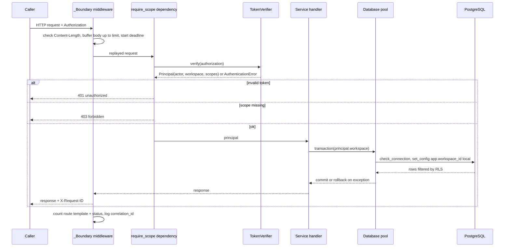
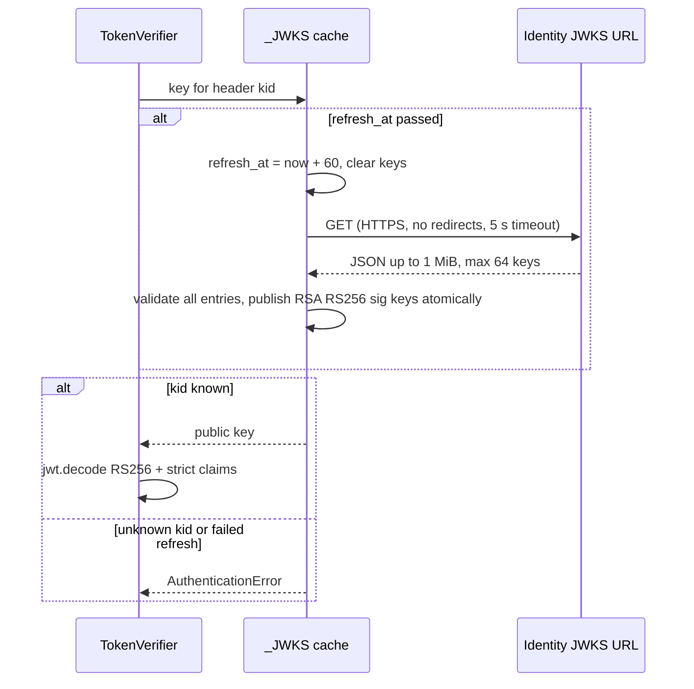
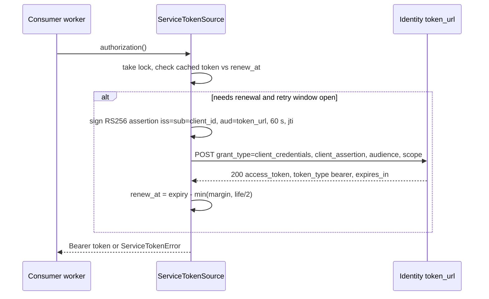
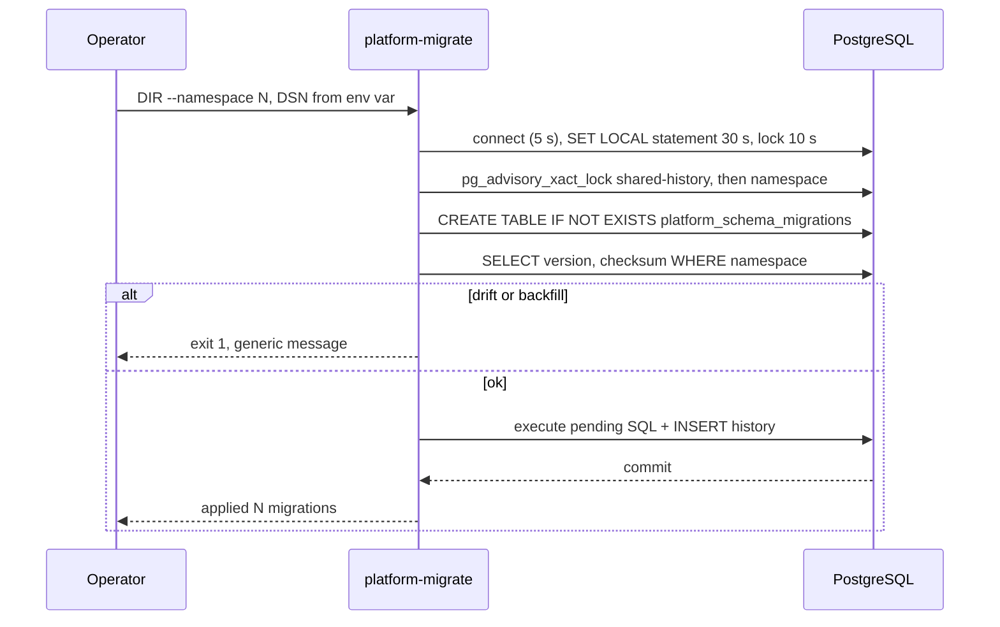

# 10 — Sequences

## 1. Authenticated request ใน consumer ที่สร้างด้วย `create_app`

Sources: src/platform_backend_core/http.py, auth.py, db.py, docs/runtime.md (HTTP integration)

## 2. JWKS key lookup

Sources: src/platform_backend_core/auth.py (`_JWKS`), runtime_tests/test_auth.py

## 3. Service token (client_credentials + private_key_jwt)

Sources: src/platform_backend_core/service_token.py, runtime_tests/test_service_token.py, platform-workflow/src/platform_workflow/cli.py (consumer, sibling repo)

## 4. `platform-migrate`

Sources: src/platform_backend_core/migrations.py

## Open questions

- ไม่มี
