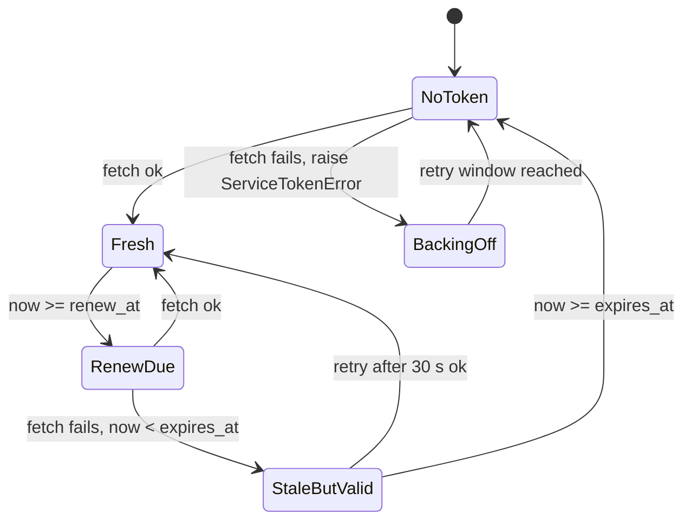
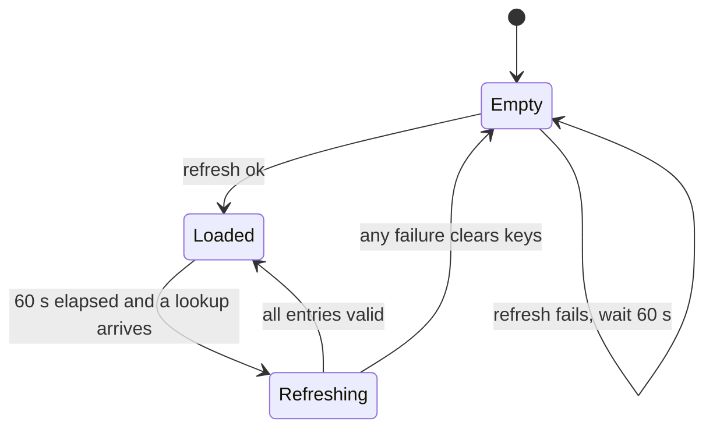
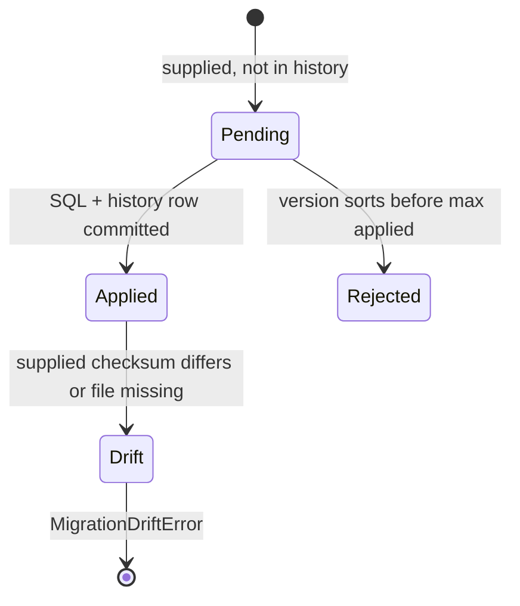

# 11 — State machines

core ไม่มี entity ใน DB ที่มี status field; lifecycle ที่มีจริงในโค้ดคือ token cache ของ `ServiceTokenSource`, JWKS cache และ migration history
และ field `status` ของ contract schema (enum เท่านั้น)

## ServiceTokenSource

Sources: src/platform_backend_core/service_token.py (`authorization`, `_fetch`, `RETRY_AFTER_FAILURE_SECONDS`), runtime_tests/test_service_token.py

## JWKS cache

Sources: src/platform_backend_core/auth.py (`_JWKS.__call__`)

## Migration version (per namespace)

Sources: src/platform_backend_core/migrations.py

## Contract `status`

schema กำหนดแค่ค่า `scaffolded`, `pilot`, `active`, `retired` ไม่มีกฎ transition ใน code (contracts/book-platform.contract.v1.schema.json)

## Open questions

- มีลำดับ transition ของ contract `status` ที่ตั้งใจไว้หรือไม่ (เช่น ห้าม retired → active)?
