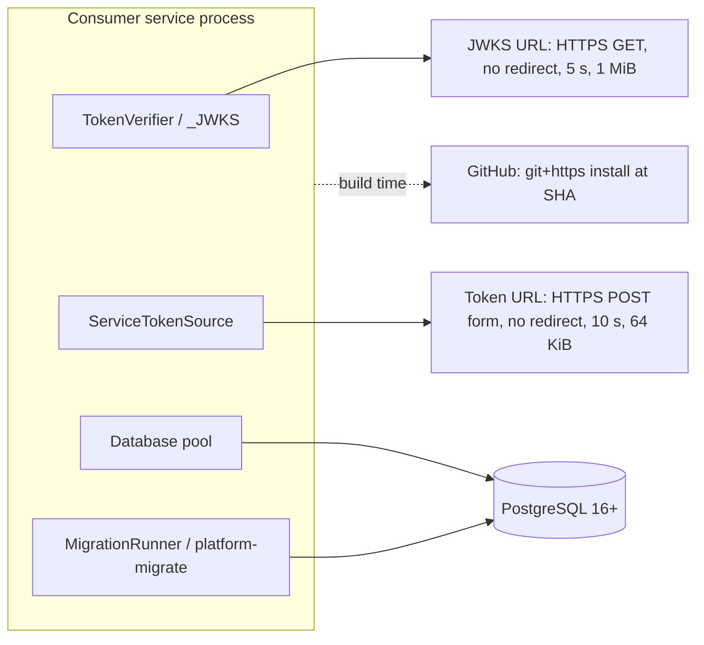

# 12 — API & integrations

## HTTP endpoints ที่ `create_app` ใส่ให้ทุก consumer

| Method | Path | Auth | Response |
|---|---|---|---|
| GET | `/healthz` | none | `{"status":"ok"}` |
| GET | `/readyz` | none | 200 `ready` / 503 `unavailable` (DB `SELECT 1` + `app.state.readiness_checks` ต้อง `True` ทุกตัว) |
| GET | `/metrics` | none | Prometheus text: `platform_http_requests_total{route,status}`, `platform_http_request_duration_seconds_sum` |
| any | consumer routes | `require_scope(scope)` | 401 / 403 / 400 / 413 / 422 / 500 / 504 แบบ generic + header `X-Request-ID` |

Sources: src/platform_backend_core/http.py, docs/runtime.md (HTTP integration)

## Library (Python) API — reused

ดู [docs/runtime.md — Stable public interface](../runtime.md#stable-public-interface) (ไม่คัดลอก) และ `__all__` ใน `src/platform_backend_core/__init__.py`
(เพิ่ม `ServiceTokenSource`, `ServiceTokenError` ซึ่ง runtime.md ยังไม่ได้ลง)

## External integrations

Sources: src/platform_backend_core/auth.py, service_token.py, db.py, migrations.py, docs/runtime.md (Installation)

| Integration | Library / SDK | ใครตั้งค่า |
|---|---|---|
| Identity JWKS | `urllib` + PyJWT `PyJWK` | consumer ส่ง `jwks_url`; production = platform-identity `/.well-known/jwks.json` (ops record: book-platforms-status, 2026-11-03) |
| Identity token endpoint | `urllib` POST + PyJWT encode | consumer ส่ง `token_url`; platform-workflow ใช้ `issuer + '/v1/token'` (platform-workflow/src/platform_workflow/cli.py) |
| PostgreSQL | `psycopg` 3 + `psycopg_pool` | consumer DSN |
| ไม่มี | payment, email, model provider SDK | runtime.md: "No payment, email or model provider SDK is required" |

ไม่มี webhook ใน core

## Open questions

- docs/runtime.md ยังไม่บันทึก `ServiceTokenSource` ใน Stable public interface
