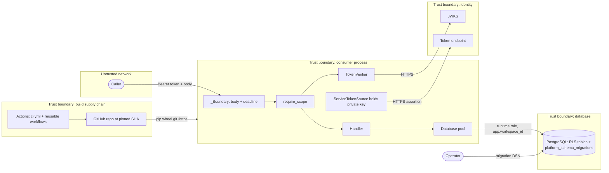

# 13 — Threat model (DFD + STRIDE)

ขอบเขต: โค้ดของ core เมื่อทำงานใน consumer + supply chain ที่ consumer ติดตั้ง core

Sources: src/platform_backend_core/*.py, .github/workflows/ci.yml, docs/runtime.md, platform-commerce/Dockerfile (consumer install)

## STRIDE

| Element | Threat | Mitigation in code | Gap |
|---|---|---|---|
| TokenVerifier | **S** forged token / alg confusion | RS256 only, `crit` rejected, exact iss/aud, required claims, size 16 KiB (auth.py) | — |
| TokenVerifier | **S/E** delegated token misuse | `del`/`obo` presence rejected (auth.py) | no revocation, `jti` not checked for replay (runtime.md says service-owned) |
| _JWKS | **T** key injection via redirect / huge doc | HTTPS only, no redirects, 1 MiB/64 keys, atomic publish (auth.py) | — |
| _JWKS | **D** identity outage | refresh ≤1/min | failed refresh clears cache → all requests 401 until next refresh (by design, fail closed) |
| Workspace | **E/I** cross-tenant read/write | `ws` from signed token only; `set_config` local; RLS FORCE required; NOBYPASSRLS role check; pool reset (db.py) | core does not verify consumer tables actually have RLS |
| _Boundary | **D** large/slow bodies | Content-Length + streamed byte limit, `asyncio.wait_for` deadline (http.py) | no rate limit or concurrency limit in core (runtime.md: deployment's job) |
| Errors / logs | **I** leaking input, tokens | generic error bodies, validation not echoed, log = route template/status/id, metrics labels = templates (http.py) | server access logger config left to consumer |
| /metrics, /readyz | **I** diagnostics exposed | no secrets in output | endpoints are unauthenticated; runtime.md says expose via controlled ingress |
| ServiceTokenSource | **I** key/token leak | key never in repr/errors, response not echoed, no redirects, 64 KiB cap (service_token.py) | key passed as PEM string in process memory/env |
| ServiceTokenSource | **R** | assertion has `jti`, 60 s life | no local audit log of token fetches |
| MigrationRunner | **T** history tampering / race | SHA-256 history, drift error, advisory locks, single transaction (migrations.py) | migration SQL is trusted release code |
| platform-migrate | **I** DSN leak | DSN only from env, generic failure message (migrations.py) | CLI untested |
| Supply chain | **T** dependency confusion / mutable ref | consumers pin full SHA in uv sources + Dockerfile; CI actions SHA-pinned for reusable workflows (ci.yml) | `actions/checkout@v4`, `setup-python@v5` tag-pinned; no tags/signing of core releases; no required review on main (branch protection: only `starter-contract`, reviews null) |
| CI | **E** | `permissions: contents: read`; reusable `security.yml` scan | contents of `security.yml` not in this repo |

Sources: src/platform_backend_core/auth.py, http.py, db.py, migrations.py, service_token.py, .github/workflows/ci.yml, docs/runtime.md; branch protection via `gh api repos/bookchaowalit-backend/platform-backend-core/branches/main/protection` (2026-11-03)

## Open questions

- ต้องการ required review บน main หรือไม่ (ตอนนี้มีแค่ status check `starter-contract`)?
- `lint-and-test` และ `security` ไม่ได้เป็น required check — ตั้งใจหรือไม่?
