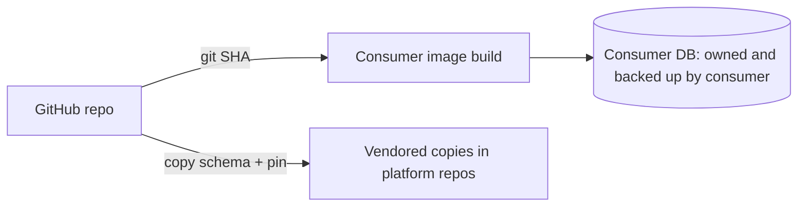

# 14 — Backup & DR

**Status: not_applicable (สำหรับ runtime ของ repo นี้)** — repo นี้ไม่มี service, container หรือ datastore ของตัวเอง
(PRODUCT.md: "No service, container or worker is built or deployed from this repository")

## ข้อมูลที่เกี่ยวข้องและที่อยู่

| ข้อมูล | อยู่ที่ไหน | Backup / restore จริง |
|---|---|---|
| Source + canonical schema + pin | GitHub `bookchaowalit-backend/platform-backend-core` | git history; สำเนา schema+pin vendored ในทุก platform repo (contracts/README.md) |
| Released runtime | ไม่มี artefact; consumer build จาก commit SHA | rebuild ได้ตราบที่ commit ยังอยู่บน GitHub; ไม่มี tag กันการลบ branch (85b066f ที่ platform-identity pin อยู่บน branch `codex/shared-infrastructure-20261015` เท่านั้น) |
| `platform_schema_migrations` + tenant tables | DB ของแต่ละ consumer | เป็นของ consumer — ดู pack 14 ของแต่ละ platform repo |

Sources: PRODUCT.md, contracts/README.md, docs/runtime.md, src/platform_backend_core/migrations.py, platform-identity/pyproject.toml (sibling), `git branch -a --contains 85b066f`

RTO/RPO: not defined

## Open questions

- ควร tag commit ที่ consumer pin ไว้ (21d5f44, dc1fa7d, 85b066f) เพื่อกันการหายจาก branch cleanup หรือไม่?
