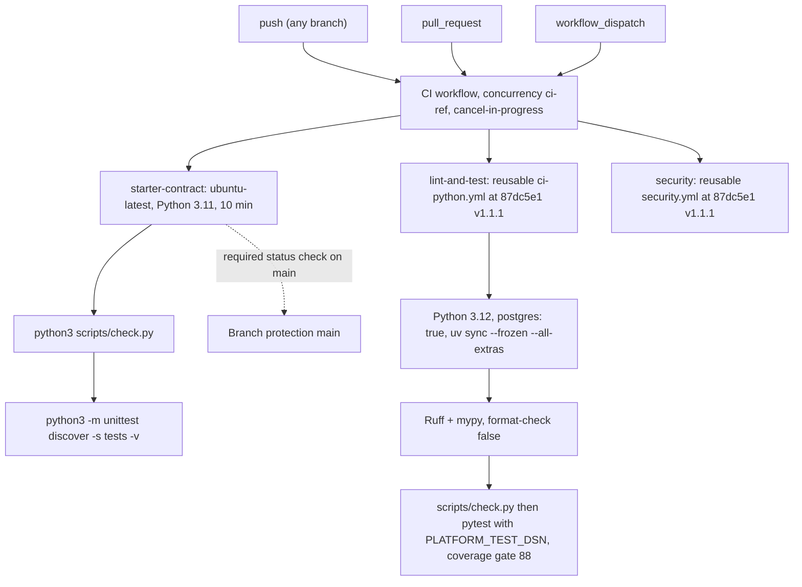

# 15 — CI/CD pipeline

workflow เดียว `.github/workflows/ci.yml` (name `CI`); ไม่มี CD เพราะไม่มีอะไร deploy

ทั้ง 3 job ไม่มี `needs` ต่อกัน (รันขนาน)

Sources: .github/workflows/ci.yml, README.md (CI), branch protection API (2026-11-03); ขั้นตอนภายใน `ci-python.yml` อ้างตาม comment ใน ci.yml และ README.md (ไฟล์อยู่ใน repo `bookchaowalit/platform-ci-workflows`)

ผล run ล่าสุด: ทุก run บน `main` ตั้งแต่ 2026-08-04 ถึง 2026-10-29 = success (`gh run list -R bookchaowalit-backend/platform-backend-core --limit 100`)

repo เป็น PUBLIC (`gh repo view --json visibility`, 2026-11-03) จึงใช้ GitHub-hosted runner ตามนโยบาย

## Open questions

- `lint-and-test` / `security` ไม่ใช่ required check (มีแค่ `starter-contract`) — ตั้งใจหรือไม่?
