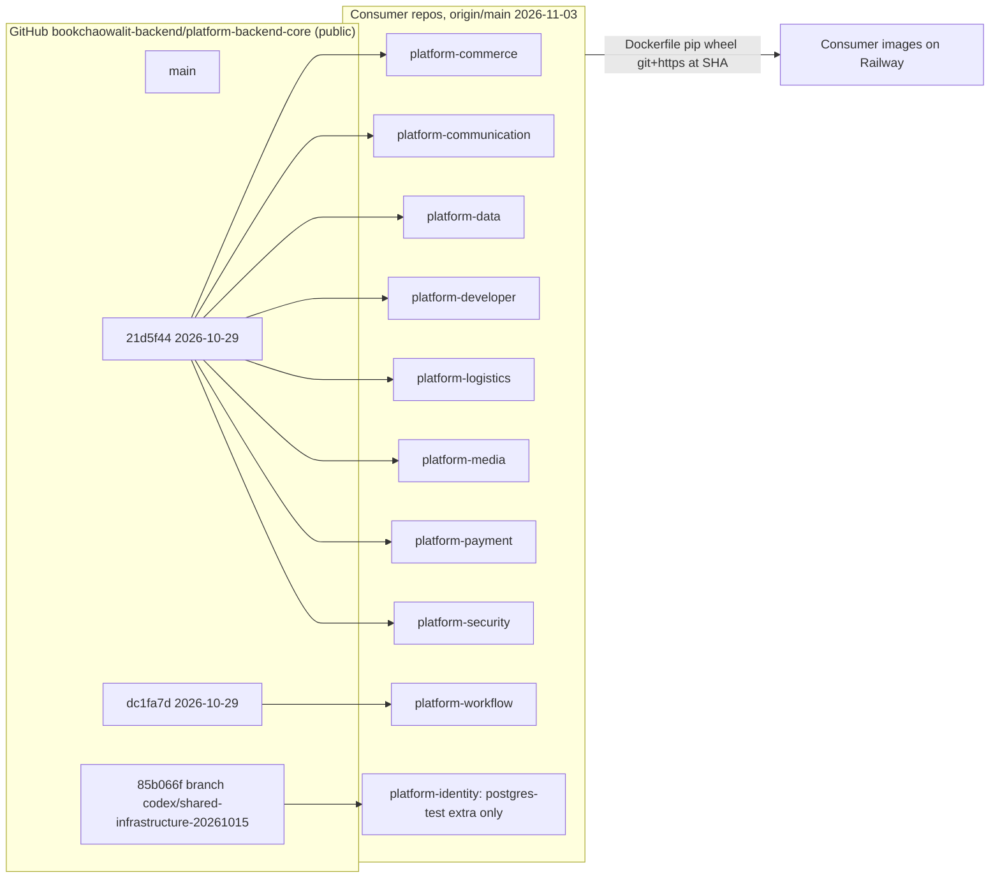

# 16 — Deployment (distribution to consumers)

library ไม่มี hosted runtime; "deployment" = consumer ติดตั้ง core จาก git commit SHA แล้ว build image ของตัวเอง
(ADR-0002 ใน [08-adr](08-adr/ADR-0002-distribute-by-pinned-git-commit.md))

| Consumer | Pin | Where |
|---|---|---|
| commerce, communication, data, developer, logistics, media, payment, security | `21d5f44d26220080cbed43b9807979dc84a8533a` | `pyproject.toml` `[tool.uv.sources]` + `Dockerfile` |
| workflow | `dc1fa7d2693594b3c79b0b2539a83a6a9465a560` | `pyproject.toml` `[tool.uv.sources]` |
| identity | `85b066fa5e02c960f013ed39a2f0473f2b2ef451` | `pyproject.toml` optional extra `postgres-test` (python ≥3.12) |

Sources: sibling worktrees `~/work/core22/platform-*/pyproject.toml` and `Dockerfile` (origin/main), docs/runtime.md (Installation), PRODUCT.md; Railway hosting: ops record: book-platforms-status (2026-11-03)

Schema distribution: vendored copy `schema/book-platform.contract.v1.schema.json` + `.sha256` ในแต่ละ platform repo (contracts/README.md; 10 repos ตาม docs/DECISION.md)

ไม่มี domain, env หรือ datastore ของตัวเอง

## Open questions

- platform-identity pin commit ที่ไม่อยู่บน main (85b066f) — ควร repin เป็น commit บน main หรือไม่?
- 8 consumers ยังอยู่ที่ 21d5f44 (ก่อน `ServiceTokenSource`) — ตั้งใจ repin เมื่อจำเป็นเท่านั้น?
