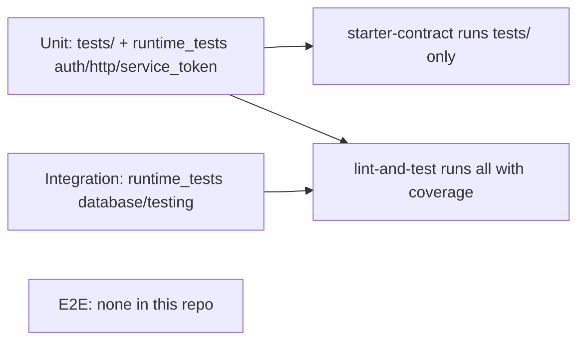

# 17 — Test coverage matrix

ระดับ: **unit** = ไม่ต้องใช้ DB/network จริง; **integration** = PostgreSQL จริง (`PLATFORM_TEST_DSN`, ใน CI คือ `$DATABASE_URL` ของ `postgres: true`);
**e2e** = ไม่มีใน repo นี้ (การทดสอบกับ service จริงเป็นของ consumer — runtime.md)

| Feature | Unit | Integration (real PostgreSQL) | E2E | Test file |
|---|---|---|---|---|
| Schema subset / fixtures / main exit codes | yes (8) | — | — | tests/test_check.py |
| Schema pin | yes (4) | — | — | tests/test_platform_sync.py |
| Platform sync compare | yes (5, temp dirs) | — | — | tests/test_platform_sync.py |
| TokenVerifier claims / alg / config | yes | — | — | runtime_tests/test_auth.py |
| JWKS refresh + failure | yes (monkeypatched fetch) | — | — | runtime_tests/test_auth.py |
| Delegation rejection | yes | — | — | runtime_tests/test_auth.py |
| HTTP boundary, 401/403, errors, metrics, readiness | yes (DatabaseFixture stub) | — | — | runtime_tests/test_http.py |
| RLS transaction, rollback, pool reuse | — | yes | — | runtime_tests/test_database.py |
| Privileged role refusal | — | yes | — | runtime_tests/test_database.py |
| Pool bounds / timeouts defaults | yes | yes (exhaustion, dead connection) | — | runtime_tests/test_database.py |
| Migrations drift / lock / namespaces | — | yes | — | runtime_tests/test_database.py |
| `platform-migrate` CLI | **gap** | **gap** | — | none |
| Disposable DB fixture | — | yes | — | runtime_tests/test_testing.py |
| ServiceTokenSource | yes (FakeIdentity, fake clock) | — | — | runtime_tests/test_service_token.py |
| ServiceTokenSource default transport, no redirect | — | yes (loopback `http.server` in the test, no DB) | — | runtime_tests/test_service_token.py `test_default_transport_*` |

Coverage gate: 88% (measured 88.41% on 2026-10-24 per comment in ci.yml); scope `src/platform_backend_core` + `scripts` (pyproject.toml)

Sources: tests/*.py, runtime_tests/*.py, .github/workflows/ci.yml, pyproject.toml, README.md, docs/runtime.md

## Open questions

- ต้องการ test ของ `platform-migrate` (migrations.main) หรือไม่?
