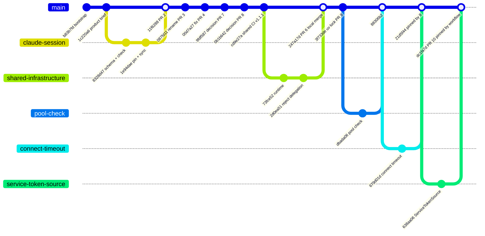
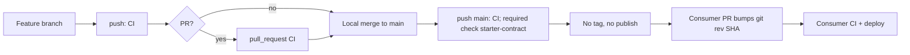

# 18 — Git & release workflow

ภาพย่อ: แสดงเฉพาะ commit หลัก (ดูเต็มด้วย `git log --graph --oneline origin/main`)

Sources: `git log --graph origin/main` (2026-11-03), `gh pr list --state all` (PR #6 closed, merged locally as 247a17d)

Sources: .github/workflows/ci.yml, branch protection API (required `starter-contract`, enforce_admins true, no required reviews), gh pr list, consumer pyproject.toml pins

## Open questions

- ไม่มี release tag / CHANGELOG — consumer รู้ว่า commit ไหน "reviewed" จากอะไร?
