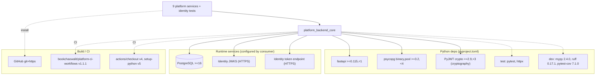

# 19 — Service dependency map

Sources: pyproject.toml, uv.lock, .github/workflows/ci.yml, src/platform_backend_core/auth.py, service_token.py, db.py, docs/runtime.md (PostgreSQL >=16), consumer pins (16-deployment.md)

ไม่มี CDN, queue หรือ object store

## Open questions

- ไม่มี
