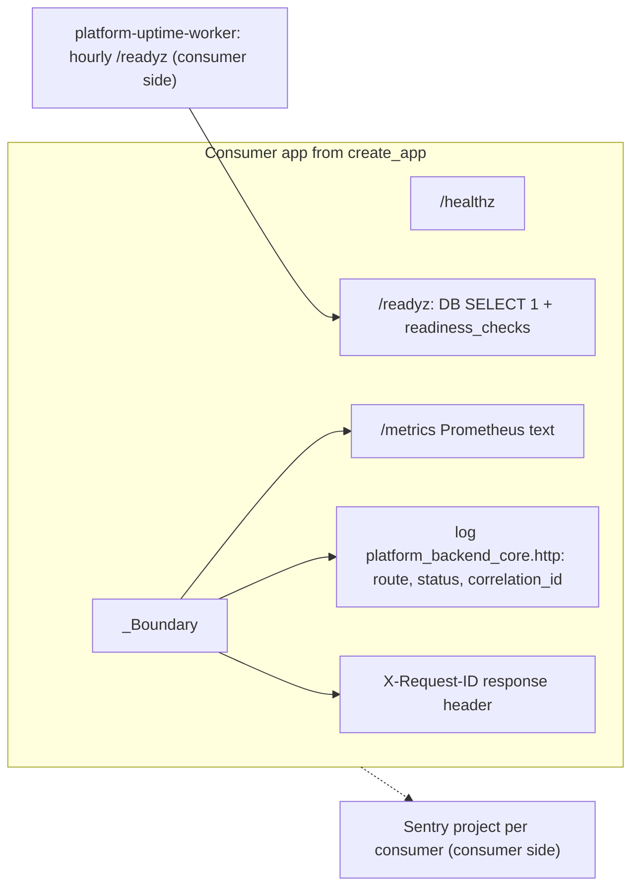

# 20 — Observability

core ไม่มี runtime จึงไม่ส่ง Sentry เอง (PRODUCT.md) แต่ **ให้ signal** แก่ consumer ทุกตัวที่ใช้ `create_app`

| Signal | Source in core | ใครเฝ้า |
|---|---|---|
| `platform_http_requests_total{route,status}` | http.py | ไม่พบ scraper ที่ตั้งค่าไว้ |
| `platform_http_request_duration_seconds_sum` | http.py | ไม่พบ |
| request log line | http.py logger `platform_backend_core.http` | logs ของ host consumer |
| `/readyz` | http.py | platform-uptime-worker hourly (ops record: book-platforms-status, 2026-11-03) |
| Sentry | ไม่มีใน core; consumer ใส่ `sentry-sdk` เอง | Sentry `platform-<svc>` (ops record: book-platforms-status, 2026-11-03; consumer pyproject.toml) |

Sources: src/platform_backend_core/http.py, PRODUCT.md (Limits), docs/runtime.md, consumer pyproject.toml (`sentry-sdk`), ops record: book-platforms-status (2026-11-03)

## Open questions

- มีใคร scrape `/metrics` ของ service จริงหรือไม่? (ไม่พบ config)
- ไม่มี histogram/latency bucket — มีแค่ sum ของ duration
