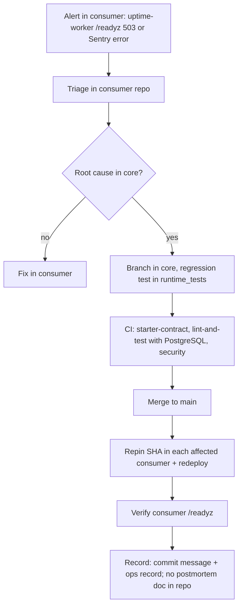

# 21 — Incident response

core ไม่มี alert ของตัวเอง; incident ของ core = defect ที่พบผ่าน consumer ใน production
ตัวอย่างจริง 2026-10-29: Neon suspend compute ทำให้ pool connection ตาย → แก้ใน core (dbada06, 679d01d) → merge 21d5f44 → consumers repin

Sources: git log (dbada06 "fix(db): check pooled connections before use", 679d01d "fix(db): wait for serverless Postgres to resume", 21d5f44 merge), src/platform_backend_core/db.py, runtime_tests/test_database.py, ops record: book-platforms-status (2026-11-03) "Core fixes found in production"

Alert channels (consumer side, จาก ops record): platform-uptime-worker, Sentry `platform-<svc>`; Telegram routing อยู่ใน solo-empire monitor ไม่ได้อยู่ใน repo นี้

## Open questions

- ไม่มี runbook/postmortem template ใน repo — ใช้ของ central หรือไม่?
- การ repin ไปหลาย consumer ทำมือทีละ repo — มี checklist หรือไม่?
