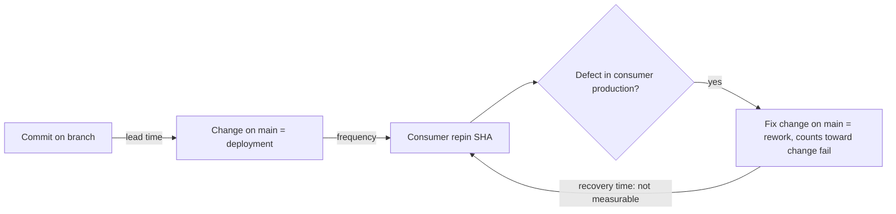

# 22 — DORA metrics

ช่วงวัด: 90 วัน 2026-08-05 → 2026-11-03 ที่ `origin/main` `dc1fa7d`
นิยามสำหรับ library: **deployment = change ที่ลง `main`** (first-parent commit) เพราะ consumer ติดตั้งจาก SHA บน main;
"release ที่ถูกใช้จริง" = commit ที่ consumer pin (ดู [16-deployment.md](16-deployment.md))

| Metric | วิธีวัดสำหรับ repo นี้ | ค่า (90 วัน) |
|---|---|---|
| Deployment frequency | นับ first-parent commits บน main | **14 changes** (~1.1/สัปดาห์); release ที่ consumer pin บน main: **2** (21d5f44, dc1fa7d) |
| Lead time for changes | merge commit: เวลา author ของ commit แรกใน branch → committer time ของ merge; direct/squash: author → committer | **median 0 นาที** (n=14); ค่าที่ไม่เป็นศูนย์: 1, 1, 2, 5, 518 (PR #2), 12087 นาที (~8.4 วัน, PR #6) |
| Change fail rate | change ที่ต้องมี fix ตามมาหลังใช้ใน production (จาก ops record) / changes; บวก CI fail บน main | **1/14 ≈ 7% (inferred)**: 247a17d runtime → แก้ใน 88306b2 + 21d5f44 หลังพบใน production; CI บน main fail **0/14** |
| Failed deployment recovery time | เวลา detect → fix merged | **cannot compute**: ไม่มีเวลาที่ตรวจพบ (fix merged 2026-10-29 12:09 +0700) |
| Deployment rework rate | change บน main ที่เป็นการแก้ change ก่อนหน้า / changes | **4/14 ≈ 29%**: 00d7a27, 7474ddc, 88306b2, 21d5f44 |

Commands (รันใน repo, 2026-11-03):

```bash
# deployment frequency
git log origin/main --since=2026-08-05 --first-parent --format='%h %ad %s' --date=iso
# lead time (minutes), per first-parent change
for m in $(git log origin/main --since=2026-08-05 --first-parent --format=%h); do
  p=$(git rev-list --parents -n1 $m | wc -w)
  if [ $p -gt 2 ]; then first=$(git log --format=%at $m^1..$m^2 | sort -n | head -1); else first=$(git log -1 --format=%at $m); fi
  echo $(( ($(git log -1 --format=%ct $m) - first) / 60 ))
done | sort -n
# CI outcome on main
gh run list -R bookchaowalit-backend/platform-backend-core --limit 100 \
  --json createdAt,event,headBranch,conclusion --jq '.[] | select(.headBranch=="main") | "\(.createdAt) \(.conclusion)"'
# fix-type changes
git log origin/main --since=2026-08-05 --first-parent --format='%h %s'
```



Sources: git log origin/main, gh run list (2026-11-03), consumer pins (16-deployment.md), ops record: book-platforms-status (2026-11-03)

ข้อจำกัด: squash/rebase ทำให้ author time ใกล้ committer time → lead time ต่ำเกินจริง; ไม่มี deploy log ของ library

## Open questions

- จะวัด recovery time อย่างไร (บันทึกเวลา detect ใน issue/Linear)?
- ควรนับ "deployment" ที่ consumer repin แทน merge main หรือไม่?
